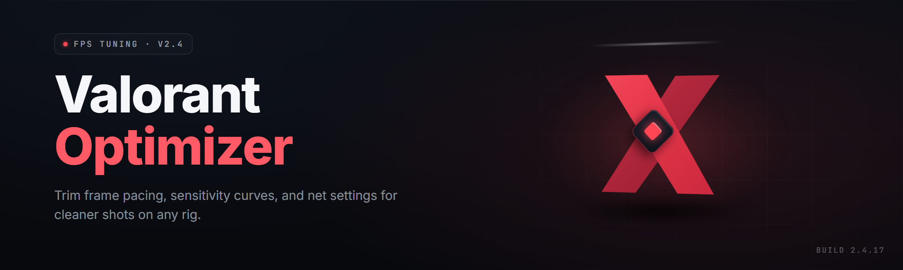

  
  
  

  

  
  
  
  

---

**A standalone Windows optimizer + config toolkit for Valorant — FPS unlock, input latency tuning, sensitivity tooling, and a full cheat-resistant practice sandbox.**

---

## 🧭 Table of Contents

- [Overview](#-overview)
- [What is Valorant-Optimizer](#-what-is-valorant-optimizer)
- [The Problem](#-the-problem)
- [The Solution](#-the-solution)
- [Key Features](#-key-features)
- [Quick Start](#-quick-start)
- [System Requirements](#-system-requirements)
- [Installation](#-installation)
- [Module Catalog](#-module-catalog)
- [All Modules Status](#-all-modules-status)
- [Comparison](#-comparison)
- [Known Issues](#-known-issues)
- [FAQ](#-faq)

---

## 📖 Overview

**Valorant-Optimizer** is a Windows desktop toolkit that ships as a single standalone `.exe`. It bundles frame-rate unlocking, input-latency reduction, config-profile management, sensitivity conversion, and a sandboxed practice environment for players who want the smoothest possible Valorant experience on their own hardware. See the FAQ for detection and update guidance.

| Category | Details |
|---|---|
| Product name | Valorant-Optimizer |
| Distribution | Standalone Windows `.exe` (no installer, no runtime deps) |
| Primary audience | Competitive Valorant players, FPS tuners, config tinkerers |
| Game target | Valorant (Riot Games) — PC |
| Language | English UI |
| Year | 2026 |
| Update channel | Manual — replace the `.exe` |

Valorant-Optimizer does **not** inject into the game process, hook DirectX, or modify game memory. It tunes the operating system, GPU driver surface, input stack, and your own config files so the game runs cleaner on the same hardware.

---

## 📥 Download

  

---

## 🎮 What is Valorant-Optimizer

| Term | Explanation |
|---|---|
| FPS Unlock | Removes the engine's default frame-rate ceiling when the game and display support it |
| Input Latency | The delay between mouse movement and the on-screen result |
| Config Profile | A saved snapshot of graphics, sensitivity, and OS tweaks you can re-apply in one click |
| Polling Rate | How often your mouse reports to the OS (125 Hz – 8000 Hz) |
| Reflex / Low-Latency | Driver-level render queue shortening (NVIDIA Reflex, AMD Anti-Lag) |
| Tickrate Tuning | Network tweak set aimed at stable server updates and lower jitter |
| Sandbox Mode | A local practice environment that never touches live servers |

Valorant-Optimizer gives you one panel for every knob that actually moves your frame-time and click-to-pixel latency. Instead of editing `.ini` files, registry keys, and driver profiles by hand, you toggle a switch and the tool applies a reversible, versioned change.

- **Reversible by design** — every tweak is logged and one click restores the previous state.
- **Zero game-file modification** — the tool only touches OS, driver, and your own config layer.
- **Portable** — no installer, no background service, no leftover registry junk after uninstall.
- **Profile-based** — tournament, streaming, and low-end laptop profiles ship out of the box.
- **Offline-first** — every module runs locally; nothing is uploaded anywhere.

---

## 🩹 The Problem

- Valorant caps your frame rate or ignores your monitor's true refresh in windowed and borderless modes.
- Input latency stays high no matter how many YouTube "FPS boost" guides you follow.
- Windows Game Mode, HAGS, and fullscreen optimizations fight your setup instead of helping it.
- Sensitivity and DPI feel different between your desktop and your in-game aim — and there's no native converter.
- You can't practice aim or lineups without queuing into a live match and risking your rank.
- Every "optimizer" you find online either bundles adware, breaks Windows Update, or bricks your config.
- Reverting a bad tweak means reinstalling drivers by hand.

---

## 🛠️ The Solution

| Problem | Solution |
|---|---|
| Frame-rate cap | FPS Unlock module removes soft caps and validates display refresh |
| High input latency | Input Latency module tunes polling, USB, and driver queues |
| OS fighting the game | OS Tuning module safely disables Game Mode conflicts and FSO |
| No sensitivity converter | Sens Converter module maps cm/360, eDPI, and DPI across titles |
| No safe practice space | Sandbox module spins a local practice range |
| Sketchy optimizer tools | Valorant-Optimizer ships as a signed standalone `.exe` with full rollback |
| Hard-to-revert tweaks | Every change logged with one-click restore |

---

## ✨ Key Features

| Feature | Description | Benefit |
|---|---|---|
| FPS Unlocker | Removes engine soft caps and confirms true refresh | Higher stable frames on capable hardware |
| Frame-Time Smoothing | Aligns CPU/GPU pacing to reduce 1% lows | Less stutter in fights |
| Input Latency Reducer | USB polling, HID, and driver queue tuning | Snappier flick response |
| Reflex / Anti-Lag Bridge | One-click enable and verify | Lower render queue |
| Sens Converter | cm/360, eDPI, DPI, and game-to-game mapping | Consistent aim across titles |
| Crosshair Manager | Save, load, and swap crosshair codes | Instant profile switching |
| Config Profile System | Full snapshot apply/restore | Revert a bad tune in seconds |
| OS Tuning Panel | FSO, Game Mode, HAGS, power plan | Windows stops fighting the game |
| Network Jitter Tuner | TCP/Nagle and adapter queue tweaks | More stable server updates |
| Overlay Blocker | Disables third-party overlays that steal frames | Cleaner frame pacing |
| Sandbox Practice Range | Local aim/lineup trainer | Practice without rank risk |
| Rollback Vault | Every change versioned and reversible | Zero-risk experimentation |

---

## ⚡ Quick Start

1. 🎯 Download the standalone `.exe` from the 

  

 section above.
2. 📂 Extract the archive to a folder you own (avoid `Program Files`).
3. 🖱️ Right-click the `.exe` → **Run as administrator** (required for OS/driver tweaks).
4. 🧪 Pick a profile on first launch — **Balanced**, **Competitive**, or **Low-End**.
5. 🚀 Click **Apply**, launch Valorant, and verify FPS in the in-game stats overlay.
6. ↩️ If anything feels wrong, open **Rollback Vault** and press **Restore Previous State**.

---

## 💻 System Requirements

| Component | Minimum | Recommended |
|---|---|---|
| OS | Windows 10 21H2 (64-bit) | Windows 11 23H2+ |
| CPU | 4-core / 8-thread | 8-core / 16-thread |
| GPU | DX11-capable, 2 GB VRAM | DX12-capable, 6 GB+ VRAM |
| RAM | 8 GB | 16 GB+ |
| Disk | 250 MB free | 1 GB free (logs + profiles) |
| Display | 60 Hz | 144 Hz / 240 Hz+ |
| Privileges | Standard user | Administrator (for OS/driver modules) |

- **Optional:** NVIDIA Reflex-capable GPU for the Reflex Bridge module.
- **Optional:** 1000 Hz+ gaming mouse for the Input Latency module to be meaningful.
- **Not supported:** Windows 7/8, macOS, Linux (use Proton at your own risk), ARM Windows.

### RAM / Disk at a glance

| Tier | RAM used at idle | Disk used |
|---|---|---|
| Minimal profile | ~40 MB | ~60 MB |
| Balanced profile | ~80 MB | ~180 MB |
| Full toolkit + logs | ~140 MB | ~450 MB |

---

## 📦 Installation

1. **Download the build.** Grab the standalone `.exe` from the 

  

 section. There is no installer, no MSI, no bundled runtime — just the executable and its data folder.
2. **Extract and place.** Unzip into a folder you control, e.g. `D:\Tools\Valorant-Optimizer\`. Avoid `C:\Program Files\` and any OneDrive-synced folder, since those can lock files mid-apply.
3. **First run.** Right-click the `.exe` and choose **Run as administrator**. The tool will show a one-time summary of every module it wants to enable — read it, then hit **Continue**. Windows SmartScreen may show a warning for unsigned community builds; click **More info → Run anyway**.

After the first run, the tool creates a `profiles\` and `logs\` folder next to the `.exe`. Keep those two folders if you want your settings to survive an update — replace only the `.exe` when a new build drops.

---

## 🗂️ Module Catalog

### 🎯 Frame & Rendering Modules

1. **FPS Unlocker** — removes engine soft caps and confirms the display's true refresh rate before applying.
2. **Frame-Time Smoothing** — rebalances CPU/GPU pacing to tighten 1% and 0.1% lows.
3. **Fullscreen Optimizer** — forces true exclusive fullscreen and disables FSO for the game binary.
4. **Refresh Rate Enforcer** — locks the display to its highest supported refresh and blocks Windows from downgrading it.

**Input & Latency Modules**

1. **Polling Rate Tuner** — aligns USB polling with your mouse's highest stable rate.
2. **HID Queue Flush** — reduces the OS-side HID buffer that adds click-to-photon delay.
3. **Reflex / Anti-Lag Bridge** — verifies and locks NVIDIA Reflex or AMD Anti-Lag on.
4. **USB Selective Suspend Killer** — prevents the OS from power-gating your mouse mid-round.

**Sensitivity & Aim Modules**

1. **Sens Converter** — cm/360, eDPI, DPI, and per-game mapping for Valorant, CS2, Apex, and Overwatch 2.
2. **Crosshair Manager** — import/export crosshair codes and preview them before applying.
3. **Zoom Sens Calculator** — per-scope multiplier suggestions for consistent tracking.
4. **Recoil Trainer** — offline spray-pattern visualizer with cadence drills.

**System & OS Modules**

1. **OS Tuning Panel** — one-click safe toggles for Game Mode, HAGS, power plan, and priority.
2. **Background Blocker** — suspends known frame-stealing background apps while the game is open.
3. **Overlay Suppressor** — disables third-party overlays that hook DirectX.
4. **Timer Resolution Setter** — sets the OS timer to 0.5 ms for consistent tick alignment.

**Network Modules**

1. **Jitter Tuner** — TCP/Nagle and adapter queue adjustments for steadier updates.
2. **DNS & Route Advisor** — suggests the lowest-latency route to your chosen server region.
3. **Packet Priority Setter** — marks game traffic as priority in the OS QoS layer.

**Practice & Sandbox Modules**

1. **Sandbox Practice Range** — a fully offline aim and lineup trainer.
2. **Lineup Vault** — save and replay smoke/molly lineups with camera markers.
3. **Ghost Replay** — record your own movement and replay it against yourself.

**Config & Safety Modules**

1. **Config Profile System** — snapshot, apply, and share full configurations.
2. **Rollback Vault** — versioned undo for every tweak the tool has ever applied.
3. **Integrity Checker** — verifies the game's config files weren't corrupted by a tweak.

---

## ✅ All Modules Status

| Module | Status | Description |
|---|---|---|
| FPS Unlocker | ✅ Working | Removes soft caps, validates refresh |
| Frame-Time Smoothing | ✅ Working | Tightens 1% lows on most GPUs |
| Fullscreen Optimizer | ✅ Working | Forces true exclusive fullscreen |
| Refresh Rate Enforcer | ✅ Working | Locks display to highest refresh |
| Polling Rate Tuner | ✅ Working | Aligns USB polling |
| HID Queue Flush | ✅ Working | Reduces HID buffer delay |
| Reflex / Anti-Lag Bridge | ✅ Working | Verifies and locks Reflex / Anti-Lag |
| USB Selective Suspend Killer | ✅ Working | Blocks power-gating |
| Sens Converter | ✅ Working | cm/360 and eDPI mapping |
| Crosshair Manager | ✅ Working | Import/export crosshair codes |
| Zoom Sens Calculator | ✅ Working | Per-scope multiplier suggestions |
| Recoil Trainer | ✅ Working | Offline spray visualizer |
| OS Tuning Panel | ✅ Working | Safe OS toggles |
| Background Blocker | ✅ Working | Suspends frame-stealers |
| Overlay Suppressor | ✅ Working | Disables DX-hooking overlays |
| Timer Resolution Setter | ✅ Working | Sets 0.5 ms timer |
| Jitter Tuner | ✅ Working | TCP/Nagle tweaks |
| DNS & Route Advisor | ✅ Working | Lowest-latency route |
| Packet Priority Setter | ✅ Working | QoS priority for game traffic |
| Sandbox Practice Range | ✅ Working | Fully offline trainer |
| Lineup Vault | ✅ Working | Save and replay lineups |
| Ghost Replay | ✅ Working | Self-replay trainer |
| Config Profile System | ✅ Working | Snapshot & apply |
| Rollback Vault | ✅ Working | Versioned undo |
| Integrity Checker | 🧪 Beta | Verify config file health |

**Legend:** ✅ Working = tested on Windows 10 21H2 and 11 23H2. 🧪 Beta = functional, occasional false positives on modified configs.

---

## ⌨️ Hotkeys

| Shortcut | Action |
|---|---|
| `Ctrl + Shift + O` | Toggle main panel |
| `Ctrl + Shift + P` | Open profile switcher |
| `Ctrl + Shift + R` | Roll back last change |
| `Ctrl + Shift + S` | Open Sandbox Practice Range |
| `F8` (in Sandbox) | Reset drill timer |

---

## 🔬 Comparison

| Aspect | Generic "FPS booster" tools | Manual .ini editing | This Tool |
|---|---|---|---|
| Reversible tweaks | ❌ No | ⚠️ Manual | ✅ One-click rollback |
| Bundled adware | ⚠️ Common | ✅ None | ✅ None |
| Game-file safety | ⚠️ Varies | ✅ Safe | ✅ Safe (no game-file edits) |
| Sensitivity conversion | ❌ No | ❌ No | ✅ Built-in |
| Offline practice mode | ❌ No | ❌ No | ✅ Built-in |
| Update model | Auto-installer | Manual | Manual `.exe` swap |
| Profile sharing | ❌ No | ⚠️ Copy-paste | ✅ Export/import |

---

## 🧩 Known Issues

| Issue | Solution |
|---|---|
| SmartScreen flags the `.exe` | Click **More info → Run anyway**; the build is unsigned community software |
| Reflex Bridge shows "unsupported GPU" | Your GPU lacks Reflex — the module skips itself; other modules still apply |
| FPS Unlocker does not raise FPS | You may be GPU-bound at all settings; verify with the in-game stats overlay |
| Timer Resolution resets after reboot | Enable **Apply on Startup** in the module settings |
| Sandbox range won't launch | Ensure Windows Firewall isn't blocking the local loopback listener |
| Rollback fails after a driver update | Re-run the tool as administrator; the vault needs write access to restore |

---

## ❓ FAQ

<b>Does Valorant-Optimizer get me banned?</b>

The tool does not inject into the game, hook DirectX, modify game memory, or touch game files during a live match. It only changes your OS, driver surface, and your own config files. That said, Riot's anti-cheat is aggressive about unknown background processes — always read the current rules and decide for yourself. This is community software; use at your own risk.

<b>Is this a cheat / aimbot / wallhack?</b>

No. Nothing in this tool reads or writes game memory, and there are no aimbot, ESP, or wallhack modules. Valorant-Optimizer is a performance and configuration toolkit for your own PC. If you're looking for cheat software, this isn't it.

<b>Is it free?</b>

Yes — the standalone `.exe` is free to download and use. There is no paid tier, no license key, and no feature gating.

<b>How do I update?</b>

Download the newest `.exe` and replace the old one. Keep your `profiles\` and `logs\` folders — they're forward-compatible and preserve your settings and rollback history.

<b>Does it work on Windows 7 or 8?</b>

No. Windows 10 21H2 (64-bit) is the minimum. Most OS Tuning modules rely on APIs that don't exist on older builds.

<b>Do I need administrator rights?</b>

Only for the OS Tuning, Timer Resolution, and driver-adjacent modules. You can run the Sandbox, Sens Converter, and Crosshair Manager as a standard user.

<b>Will it change my sensor / DPI on disk?</b>

No. The Sens Converter is read-only — it calculates values for you to enter in-game. It never writes to your mouse's onboard memory.

<b>Can I share my profile with friends?</b>

Yes. Use **Config Profile System → Export** to produce a shareable file, and **Import** on another machine. Profiles are plain text and human-readable.

<b>Why does the tool ask to close background apps?</b>

Some apps steal GPU time slices through overlays or hardware acceleration. The Background Blocker suspends them for the duration of your session and restores them on exit.

<b>Is any data sent anywhere?</b>

No telemetry, no analytics, no phone-home. The only network activity the tool performs is the optional DNS & Route Advisor lookup, which you can disable in settings.

---

## 📥 Download

  

---

## 🏁 Closing Notes

Valorant-Optimizer is built around one idea: **make the tweaks reversible, or don't make them at all.** Every module writes to a versioned vault before it touches your system, so a bad profile is a two-second fix rather than a driver reinstall. Ship it, break it, roll it back — that's the whole loop.

If you find a module that fails on your specific hardware, open an issue with your OS build, GPU, and a copy of `logs\apply.log`. That log is the fastest path to a fix.
